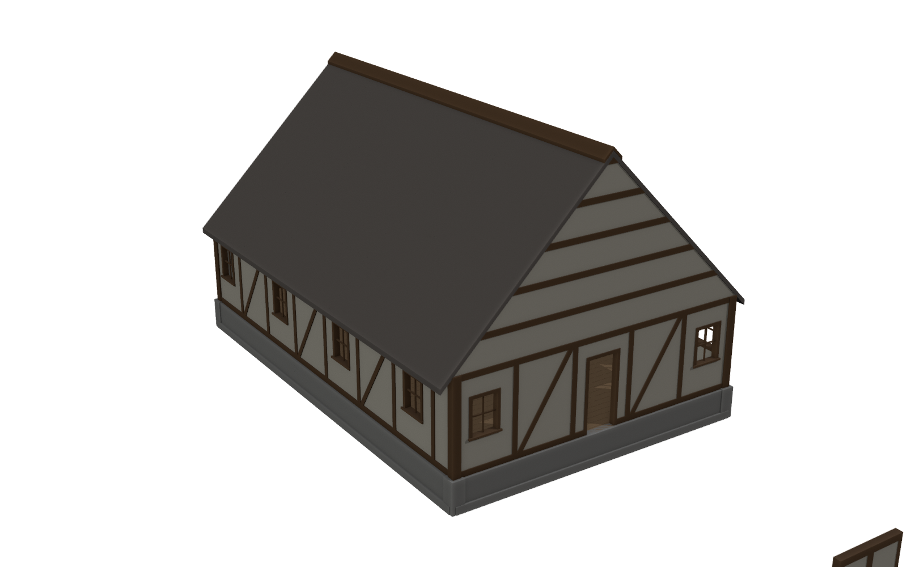

# Modular Building Generator

Blender addon for generating modular buildings — medieval houses now, castles later.

## Kit conventions

- **Grid:** 1 m. Pieces span whole grid cells (1x3, 2x3, ...).
- **Pivot:** bottom-left corner seen from outside, on the outer wall face.
  Local +X runs along the piece, +Y points into the building, +Z up.
  Rotate pieces 0/90/180/270 around Z to go around a building counter-clockwise.
- **Heights:** foundation 1 m (stone, slightly proud of the wall face),
  walls 3 m, floor tiles 1x1 with pivot on the top surface (sit at foundation top).
- **Roof:** 45° pitch, so each slope piece covers 1 m run and 1 m rise.
  Gables stack 1 m rows: a triangle at each end and fill pieces between.

## Pieces

`MB_Wall_{1,2}x3`, `MB_Wall_2x3_{Brace,Window,Door}`, `MB_Wall_Corner`,
`MB_Found_{1,2}x1`, `MB_Found_Corner`, `MB_Floor_1x1`,
`MB_Gable_Fill_{1,2}x1`, `MB_Gable_Tri_{L,R}`,
`MB_Roof_{Slope,Eave,Ridge}_{1,2}`.

## Use

Install `modular_building/` as an addon (zip it, Edit > Preferences > Add-ons > Install),
then View3D sidebar > Modular > Generate Kit + Test Building.

## Textures

Kit materials pick up Quixel Mixer exports from a texture library folder
(default `\\RANDO_NEWPC\6TB Drive\quixel mixer`; change it in the addon
preferences, or set `MB_TEXTURE_DIR`). Up to two folders deep, a file is used
when its path mentions the material's keyword and ends in a map suffix:

| Material | Keywords | Tile |
| --- | --- | --- |
| `MB_Plaster` | plaster | 2 m |
| `MB_Timber` | timber, beam | 1 m |
| `MB_Stone` | stone, cobble, rock | 2 m |
| `MB_FloorWood` | floorwood, floor, plank | 1 m |
| `MB_Shingle` | shingle, roof | 2 m |

Suffixes: `_Albedo`/`_BaseColor`, `_Normal`, `_Roughness`, `_AO`, `_Metalness`
(e.g. `Old Plaster/Old Plaster_Albedo.png`). A material without a matching
albedo keeps its flat colour. After changing the library, hit **Reload Textures**.

No library handy? Generate stand-ins laid out the same way:

    python scripts/make_fake_textures.py          # writes test_textures/ (gitignored)

Regenerate `blender/modular_kit.blend` headless:

    blender --background --factory-startup --python scripts/build_test_scene.py

Set `MB_TEXTURE_DIR=test_textures` first to build it with the fake textures.
